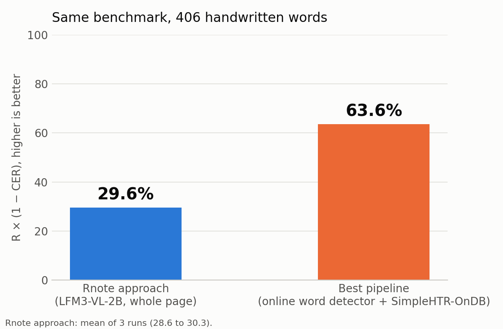

# LFM3-VL-2B

Liquid AI's pretrained vision-language model
[LFM3-VL-2B](https://huggingface.co/LiquidAI/LFM3-VL-2B), tried as handwriting
recogniser and as a page reader (issue #171). Inspired by
[an experiment](https://github.com/flxzt/rnote/issues/224#issuecomment-6626445202)
that makes handwritten Rnote notes searchable with this model.

**Optional and experimental.** It reads handwriting better than our ONNX
recognisers, but it is far slower and needs an inference server, which our
ONNX pipelines do not. No pipeline here is a default.

**Exception to ADR 006:** the weights are not our own export. The model runs in
a separate [`llama-server`](https://github.com/ggml-org/llama.cpp) that we talk
to over HTTP, so there is no new Python dependency and no extra.

Two pipelines:

| Pipeline | What it does |
|---|---|
| `2026-11-09_yolo_detector_lfm3_vl` | The YOLO detector finds the words and the model reads each crop. Word-level contract as in ADR 003. |
| `2026-11-21_rnote_lfm3_vl` | Replica of the Rnote experiment: the whole page in one call, and the model returns the word boxes itself. |



## GPU training setup

Not applicable: we have not trained or finetuned the model.

## Inference

Start a `llama-server` (build b12233 was used), which downloads the model and
its vision projector on first use:

```bash
llama-server -hf LiquidAI/LFM3-VL-2B-GGUF:Q4_0 --port 8089 \
    --reasoning off -np 1 -c 16384 -cram 0 -fa on -ctk q8_0 -ctv q8_0
```

- `--reasoning off` is required: otherwise the model spends its token budget
  thinking and returns an empty reply.
- `-np 1 -c 16384 -cram 0` keeps the memory use low. With the defaults (4 slots
  and an 8 GiB prompt cache) the server grew to about 6 GB and was
  OOM-killed on a 15 GB machine.
- `-fa on -ctk q8_0 -ctv q8_0` is about 8% faster on word crops, with
  identical output on the 10 crops tried.
- For `2026-11-21_rnote_lfm3_vl` use `-c 8192` as the Rnote experiment does.

Point the code at the server, then run a pipeline:

```bash
export XOURNALPP_HTR_LLAMA_SERVER_URL=http://127.0.0.1:8089   # default: :8080
uv run python scripts/run_benchmark.py -p 2026-11-09_yolo_detector_lfm3_vl
```

```python
from xournalpp_htr.inference_models import LFM3VLModel

model = LFM3VLModel.from_pretrained()  # checks that the server is reachable
texts = model.recognize_batch(word_images_grayscale)  # one call per crop
words = model.read_page_like_rnote(page_image_grayscale)  # [(text, BoundingBox), ...]
```

## Best model

`2026-11-09_yolo_detector_lfm3_vl` is the best of the LFM3-VL pipelines and has
the lowest CER of all pipelines (**19.6%** case-insensitive, word accuracy
**66.4%**), but it is not the pipeline of record. R×(1-CER) is **58.4%**, below
`2026-11-03_online_word_detector_hub_simple_htr_ondb` (**63.6%**), and a benchmark
run takes about 20 minutes on CPU against under 5 minutes for all ONNX pipelines
together. See [Experiments](#experiments).

## Experiments

All results below use the benchmark dataset `latest` as of 2026-11-21 (406
ground truth words, 295 matched by the YOLO detector), on CPU only (Intel
i7-8565U, 15 GB RAM). They are single runs unless noted, without significance
tests. The older tables in other model pages were measured on a smaller version
of the dataset (169 words) and are not comparable.

### 2026-11-21 — Replica of the Rnote approach

- **Hypothesis:** the page-reading approach of the Rnote experiment, run on our
  benchmark, finds and reads our words as well as our pipelines do.
- **Setup:** `2026-11-21_rnote_lfm3_vl`, code revision `28bff74`. Replicates
  [`MichaelEssich/rnote`](https://github.com/MichaelEssich/rnote), branch
  `feature/ocr`, commit `9f55d2c` (`crates/rnote-engine/src/ocr.rs`, GPL-3.0):
  the whole page in one call, its prompt and grammar verbatim, its sampling
  (temperature 0.1, top_k 50, top_p 1, min_p 0, repeat penalty 1.1), 8192 new
  tokens, page rendered with its longest edge at about 2048 px, and its box
  handling (swap reversed coordinates, clamp, drop boxes under 1 px). Nothing
  of ours on top. Differences that remain: our renderer, black strokes on white
  (the fork renders the note through its own engine), `llama-server` instead of
  `llama-cli`,
  and our scoring (a prediction must cover 80% of the ground truth box, which
  is strict for a search feature).
- **Command:** `uv run python scripts/run_benchmark.py -p 2026-11-21_rnote_lfm3_vl`,
  three times, server as above with `-c 8192`.
- **Results:**

| Run | Precision | Recall | CER (case-insens.) | R×(1-CER) | Word Acc |
|---|---|---|---|---|---|
| 1 | 36.7% | 38.7% | 22.4% | 30.0% | 73.9% (116/157) |
| 2 | 37.2% | 38.4% | 21.2% | 30.3% | 71.2% (111/156) |
| 3 | 39.7% | 36.2% | 21.0% | 28.6% | 74.8% (110/147) |
| **Mean** | **37.9%** | **37.8%** | **21.5%** | **29.6%** | **73.3%** |

  No page failed (no reply was cut off by the context limit). A run took 30 to
  35 minutes.
- **Best model:** not applicable; see the comparison below.
- **Conclusion:** the model reads the words it finds well (73% word accuracy on
  matched words) but finds only about 38% of them with a box that covers the
  word. It works as a rough locator, which is what search needs, but not for
  our word-level contract. Raw outputs: the three run logs and HTML reports.

### 2026-11-21 — Comparison with the existing pipelines

The existing pipelines, rerun on the same dataset, and the LFM3-VL ones, sorted
by R×(1-CER). Only ONNX pipelines need no server.

| Pipeline | Precision | Recall | CER (case-insens.) | R×(1-CER) | Word Acc |
|---|---|---|---|---|---|
| `2026-11-03_online_word_detector_hub_simple_htr_ondb` | 84.1% | 87.4% | 27.3% | **63.6%** | 53.8% |
| `2026-11-09_yolo_detector_lfm3_vl` | 77.0% | 72.7% | **19.6%** | 58.4% | **66.4%** |
| `2026-10-09_yolo_detector_ppocrv5` | 77.0% | 72.7% | 23.4% | 55.7% | 51.2% |
| `2026-10-17_yolo_detector_simple_htr_ondb_beam_vocab` | 77.0% | 72.7% | 24.6% | 54.8% | 60.3% |
| `2026-10-05_yolo_detector_beam_vocab` | 77.0% | 72.7% | 25.8% | 53.9% | 54.9% |
| `2026-10-17_yolo_detector_simple_htr_ondb` | 77.0% | 72.7% | 26.9% | 53.1% | 53.6% |
| `2026-09-02_yolo_detector` | 77.0% | 72.7% | 27.8% | 52.5% | 48.5% |
| `2024-07-18_htr_pipeline` | 82.3% | 73.2% | 31.0% | 50.5% | 49.5% |
| `2026-06-07_htr_pipeline_native` | 83.0% | 73.2% | 33.3% | 48.8% | 48.8% |
| `2026-10-09_ppocrv5_det_rec` | 77.3% | 51.2% | 20.7% | 40.6% | 57.2% |
| `2026-09-17_rf_detr_detector` | 79.9% | 56.9% | 30.2% | 39.7% | 48.5% |
| `2026-11-21_rnote_lfm3_vl` (mean of 3) | 37.9% | 37.8% | 21.5% | 29.6% | 73.3% |

The TrOCR pipelines were not rerun (see [Current status](#current-status)).

- **Conclusion:**
    - With the same YOLO detector (precision 77.0%, recall 72.7%), LFM3-VL is
      the best recogniser: CER 19.6% against 23.4% to 27.8% for the others, and
      word accuracy 66.4% against 60.3% for the next best.
    - The best pipeline overall wins on detection, not recognition: the online
      word detector reaches recall 87.4% with a weaker recogniser.
    - Online word detector plus LFM3-VL would combine the best detector with
      the best recogniser, but was not tried: it would send more crops to a
      model that needs about 3 s per crop.

### 2026-11-21 — Server flags and where the time goes

- **Hypothesis:** the speed flags of the Rnote experiment (flash attention,
  q8_0 KV cache, more threads) speed up the word crop pipeline.
- **Setup:** 10 YOLO crops of one example page, mean time per crop after a
  warm-up call.
- **Results:**

| Server flags | Time per crop |
|---|---|
| `-np 1 -c 16384 -cram 0` | 3.53 s |
| the same plus `-fa on -ctk q8_0 -ctv q8_0` | 3.25 s |
| the same plus `-t 8 -tb 8` | 4.07 s |

  Outputs were identical in all three. About 95% of a crop's time is prompt
  evaluation including the vision encoder (about 3 s); decoding a word takes
  0.1 to 0.15 s.
- **Conclusion:** the flags help decoding, not the encoder, so the gain on crops
  is small (about 8%). Eight threads are slower than the default of four on this
  4-core CPU with hyperthreading. The flags should matter more for page reading,
  which writes hundreds of tokens per call; not measured.

### 2026-11-10 — Page reading variants (dropped)

- **Hypothesis:** the model can return the word boxes of a page itself, and we
  can make them good enough to replace the YOLO detector.
- **Setup:** four variants of one pipeline, all with the model returning
  `{text, box}` entries under a JSON grammar. Whole page: the page as one 150
  DPI image. Strips: horizontal strips with overlap, one call each; a strip
  keeps only the words centred in the band it owns, strips without ink are
  skipped, duplicate boxes within a strip are dropped. The prompt also asked to
  skip arrows and to box a formula as one entry, and `?`-only entries were
  dropped. Snapped: each box replaced by the bounds of the pen strokes it
  holds, as the ground truth boxes are stroke bounds. Code revisions `8a228e6`,
  `fc07af2` and `f1a76b1`, removed in `199bd93`; the pipelines were
  `2026-11-09_lfm3_vl_page` and `2026-11-10_lfm3_vl_page_snapped`.
- **Results:**

| Variant | Precision | Recall | CER (case-insens.) | R×(1-CER) | Word Acc |
|---|---|---|---|---|---|
| Whole page | 33.8% | 34.7% | 25.0% | 26.1% | 71.6% |
| Strips 600/200 px | 45.0% | 44.8% | 19.8% | 36.0% | 79.1% |
| Strips 400/150 px | 32.0% | 35.0% | 30.8% | 24.2% | 70.4% |
| Strips 600/200 px, snapped | 53.4% | 51.7% | 21.3% | **40.7%** | 75.2% |
| Strips 400/150 px, snapped | 42.8% | 46.8% | 27.8% | 33.8% | 68.4% |

  Runs took 20 to 35 minutes. The whole page and strips 600/200 rows come from
  one run each, before the server was changed to the lean flags; the others
  from the lean server.
- **Conclusion:**
    - Overlaid on a page, most predicted boxes sit on the right words. The
      misses are merged, offset and extra boxes, mostly around arrows and
      formulas.
    - Strips and snapping each help, 400 px strips are worse than 600 px, and
      the best variant (recall 51.7%) is still far behind the YOLO detector
      (72.7%) and slow. Dropped; the code is in the git history.

### 2026-11-09 — YOLO detector with LFM3-VL crops

- **Hypothesis:** LFM3-VL reads word crops better than SimpleHTR, TrOCR and
  PP-OCRv5.
- **Setup:** `2026-11-09_yolo_detector_lfm3_vl`, code revision `d5b69f9`. The
  YOLO detector of `2026-09-02_yolo_detector`; one call per crop with the prompt
  "Transcribe the handwritten word in this image. Reply with the word only."
- **Command:** `uv run python scripts/run_benchmark.py -p 2026-11-09_yolo_detector_lfm3_vl`
- **Results:** precision 77.0%, recall 72.7%, CER 22.2% (case-sensitive) and
  19.6% (case-insensitive), R×(1-CER) 58.4%, word accuracy 66.4% (196/295). About
  20 minutes.
- **Best model:** this pipeline, among the LFM3-VL ones; see the comparison above.
- **Conclusion:** best recogniser, but a benchmark run takes about 20 minutes
  against under a minute for each ONNX pipeline, and it needs a server.
  Optional only.

## Current status

- `LFM3VLModel` implemented with `recognize`, `recognize_batch` and
  `read_page_like_rnote`; both pipelines are wired into `compute_predictions`.
- Needs a running `llama-server`; `from_pretrained()` raises a `ConnectionError`
  with the command to start one if none is reachable.
- Benchmarked; see [Experiments](#experiments). Single runs apart from the
  replica, so small differences are within noise.
- The TrOCR pipelines were not rerun on this dataset (`transformers` is not
  installed here and the weights are large), so the comparison is missing them.
- The replica's prompt and grammar are copied from the GPL-3.0 Rnote fork,
  credited in the code.

## Outlook

- Use the model as a teacher: pseudo-label unlabelled handwriting with it and
  train the ONNX recogniser on that, to get its reading quality without running
  it.
- Let it pre-fill transcriptions when annotating the benchmark.
- Cut the per-crop encoder cost, e.g. `--image-min-tokens` or several crops in
  one image; not tried and may cost accuracy.
- Online word detector plus LFM3-VL, if speed ever allows.
- The model is reportedly also published as ONNX; not checked.
